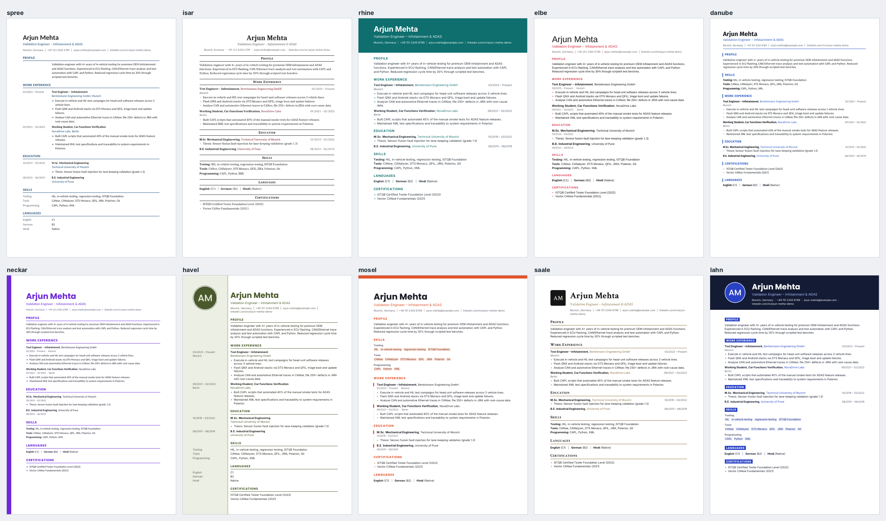

# Resume Curator

Free, open-source resume templates that look like Canva and pass ATS parsers like a plain Word file.

Resume Curator turns a plain resume (DOCX, PDF or TXT) into **10 designed templates**, each as a DOCX and a PDF. Every output is read back the way an applicant-tracking system reads it, and has to pass. It can also **tailor your resume to a job ad** without inventing anything.


*All examples use a fictional person. Browse every template as PDF/DOCX in [`examples/`](examples/).*

## Why

Most good-looking resume templates fail ATS parsing:
* two-column sidebars get read line by line across both columns;
* text boxes and page headers get skipped entirely;
* icon fonts and skill bars turn into junk characters.

Resume Curator keeps the looks and rebuilds them from safe parts:

| Look | Usual build (breaks ATS) | Resume Curator build |
|---|---|---|
| Sidebar | table / text boxes | tinted picture behind the page; sidebar text is a tab-stop gutter on the same line |
| Colour header | text box on a shape | real text over a text-free picture |
| Timeline | shapes and lines | paragraph borders |
| Skill tags / pills | shapes | character shading on real text |
| Photo / monogram circle | framed image with text | plain picture; the name stays real text |
| Bullets | Symbol/Wingdings glyphs | real `•` in the body font |
| Skill bars | graphics | text levels (CEFR for languages) |

Fonts are embedded, ligatures are off, and every PDF is a tagged PDF/A-2b. There is **no OCR**: scanned PDFs are refused, because OCR text loses ATS ranking.

## Templates

| Classic | | Studio | |
|---|---|---|---|
| `spree` | German tabular Lebenslauf, optional photo | `havel` | tinted sidebar + photo/monogram circle |
| `isar` | executive serif | `mosel` | timeline + skill tags |
| `rhine` | colour header band | `saale` | black & white serif monogram |
| `elbe` | Swiss minimal | `lahn` | navy band, badge, pill headings |
| `danube` | compact tech, skills first | | |
| `neckar` | accent stripe | | |

## Use it as a Claude skill (easiest)

1. Download this repo as a ZIP (**Code → Download ZIP**).
2. In Claude, open **Settings → Capabilities → Skills**, upload the ZIP and turn the skill on.
3. In a chat, attach your resume and say *"use resume-curator"*. Add a job ad to also get a tailored version.

Claude reads your resume, structures it, renders the templates, checks them and hands back the files.

## Use it from the command line

```bash
pip install -r requirements.txt     # plus LibreOffice and poppler-utils (see below)
cd engine
python3 curator.py selftest                                  # renders the sample in all 10, verifies
python3 curator.py convert my_resume.docx -o out/            # all templates
python3 curator.py parse my_resume.pdf -o master.json        # review the JSON, then:
python3 curator.py render master.json -o out/ --templates havel,mosel --photo me.jpg
python3 curator.py render master.json -o out/ --templates spree --lang de --signature Berlin
```

### Tailor to a job ad
```bash
python3 curator.py match  master.json job.json                    # what's missing / buried
python3 curator.py match  tailored.json job.json                  # after tailoring
python3 curator.py guard  master.json tailored.json --job job.json  # nothing invented
```
* **`match`** is the recruiter's Ctrl+F test. It shows where each job-ad term appears in your resume, and whether the ad's title and required years are visible at the top.
* **`guard`** compares a tailored resume with your master. It flags new numbers, new tools, changed employers/dates/titles/degrees, added clichés and keyword stuffing.

The method: keep one master resume. For each job, change only the headline (same role, never a higher level), a three-sentence summary, a 9–12-term core-competencies line copied from the ad, the order of your skills, and the wording and order of your top bullets. Everything else stays true and untouched. See `samples/sample_job.json` and `samples/sample_tailored.json`.

## Requirements

* Python 3.10+: `pip install -r requirements.txt`
* LibreOffice: `soffice` must be on your PATH, for the PDF export.
* poppler-utils: `pdftotext` and `pdffonts`, for reading PDFs and for the ATS check.
* Fonts: nothing to install. The fonts are bundled in `engine/fonts/` (OFL/Apache, see `engine/fonts/licenses/`) and loaded into a private LibreOffice profile for each export, so every machine produces the same PDFs. The DOCX files use Word's own fonts (Calibri, Cambria, Arial, Georgia), so they open cleanly in Word.

On Debian/Ubuntu: `sudo apt install libreoffice-writer poppler-utils`. On macOS: `brew install --cask libreoffice && brew install poppler`. On Windows: install LibreOffice (found automatically) and poppler (add its `bin` folder to PATH).

## Honest limitations

* The resume parser works by pattern-matching. Always review the JSON, or let Claude (the skill) structure it.
* DOCX files are written to Word's file rules and tested with LibreOffice.
* "ATS score" is this project's own read-back test (text-layer coverage, reading order, glyph hygiene, structure). It is not a score from any commercial ATS.

## License

MIT. Free for personal and commercial use.
