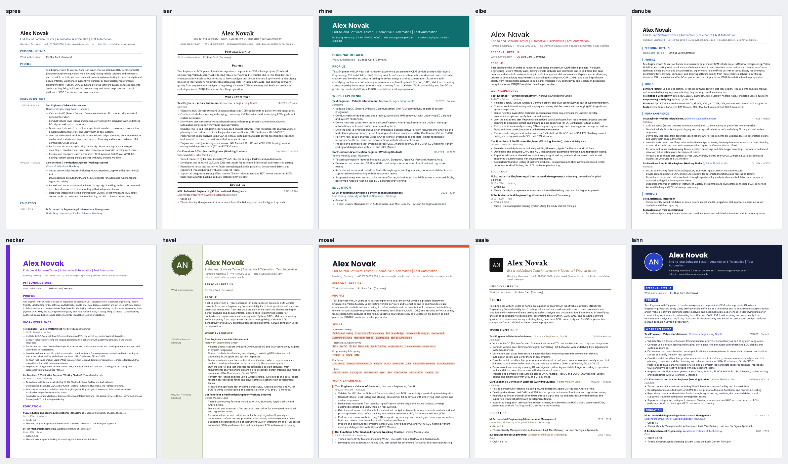

# Examples

Every template, rendered from the same fictional resume ([`alex_novak.json`](alex_novak.json)). Alex Novak, the contact details, the employers, the universities and the projects are all made up. Open the PDFs to compare designs, or the DOCX files to edit one in Word.



| Template | Style | PDF | DOCX |
|---|---|---|---|
| spree | German tabular Lebenslauf | [PDF](Alex_Novak_spree.pdf) | [DOCX](Alex_Novak_spree.docx) |
| isar | Executive serif | [PDF](Alex_Novak_isar.pdf) | [DOCX](Alex_Novak_isar.docx) |
| rhine | Colour header band | [PDF](Alex_Novak_rhine.pdf) | [DOCX](Alex_Novak_rhine.docx) |
| elbe | Swiss minimal | [PDF](Alex_Novak_elbe.pdf) | [DOCX](Alex_Novak_elbe.docx) |
| danube | Compact tech, skills first | [PDF](Alex_Novak_danube.pdf) | [DOCX](Alex_Novak_danube.docx) |
| neckar | Accent stripe | [PDF](Alex_Novak_neckar.pdf) | [DOCX](Alex_Novak_neckar.docx) |
| havel | Tinted sidebar + monogram circle | [PDF](Alex_Novak_havel.pdf) | [DOCX](Alex_Novak_havel.docx) |
| mosel | Timeline + skill tags | [PDF](Alex_Novak_mosel.pdf) | [DOCX](Alex_Novak_mosel.docx) |
| saale | Black & white serif monogram | [PDF](Alex_Novak_saale.pdf) | [DOCX](Alex_Novak_saale.docx) |
| lahn | Navy band + pill headings | [PDF](Alex_Novak_lahn.pdf) | [DOCX](Alex_Novak_lahn.docx) |

[`with-photo/`](with-photo) has the five templates that take a photo, shown with a placeholder silhouette.

[`ats_report.txt`](ats_report.txt) is the read-back check for every file above. All score 100/100.

Make your own:
```bash
cd engine
python3 curator.py render ../examples/alex_novak.json -o out/ --templates all
python3 curator.py render ../examples/alex_novak.json -o out/ --templates havel,mosel --photo me.jpg
```
